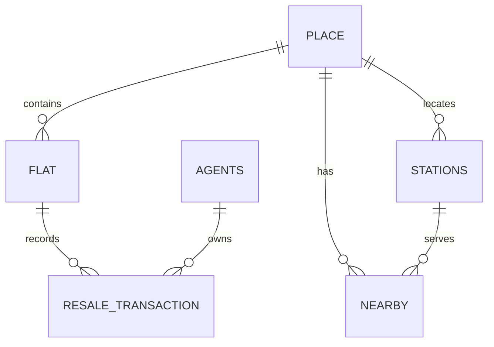

# Estate Records

**Singapore Institute of Technology · INF2003 Database Systems group project**

Estate Records is a Streamlit application for Singapore property agents to maintain HDB flat and resale records, find comparable transactions near MRT and LRT stations, and save their own searches and dashboards. MySQL stores the shared catalogue and transaction history. MongoDB stores each agent’s search criteria and analytics configuration. Loading a saved search or analytics card uses the stored configuration to query MySQL.

## Run the application

Use Python 3.14, MySQL Server 8.0 or newer, and a running MongoDB server. Use a fresh local MySQL schema and an empty MongoDB database for the grading demo. Run the following commands from the repository root in PowerShell.

1. **Install Python dependencies and create the local configuration.**

   ```powershell
   python -m venv .venv
   .\.venv\Scripts\python.exe -m pip install -r requirements.txt
   Copy-Item .env.example .env
   ```

   Set `MYSQL_USER` and `MYSQL_PASSWORD` in `.env`. Set `FLAT_RECORD_ADMIN_EMAIL` to the address you want to use for the demo administrator. Adjust the database host, port, or MongoDB URI if your services use different settings.

2. **Create the MySQL schema.** Open [setup/firstver_database.sql](setup/firstver_database.sql) in MySQL Workbench and execute the full script. If the MySQL client is on your `PATH`, you can also run the command below with an account that can create the schema.

   ```powershell
   mysql --host=localhost --port=3306 --user=YOUR_MYSQL_USER -p --execute="SOURCE setup/firstver_database.sql"
   ```

3. **Import the bundled data and build station distances.** The importer prompts for a password of at least eight characters when it creates the demo administrator. Keep that password for the grading walkthrough.

   ```powershell
   .\.venv\Scripts\python.exe -m setup.import_data_script.import
   .\.venv\Scripts\python.exe -m app.app_modules.nearby.nearby_function
   ```

   MongoDB creates the application collections on first use. See the [data import guide](setup/import_data_script/ImportInstructions.md) for the expected row counts, permissions, and import behavior.

4. **Start Streamlit.** Open the local URL printed in the terminal, usually `http://localhost:8501`.

   ```powershell
   .\.venv\Scripts\python.exe -m streamlit run app/streamlit_app.py
   ```

   On macOS or Linux, use `.venv/bin/python` for the Python commands and `cp .env.example .env` to create the configuration file.

If you already have a populated Estate Records schema, configure `.env` for that instance and skip the CSV import. Run the distance builder if the `nearby` data still need to be generated.

### Configuration

| Variable | Purpose | Example or default |
| --- | --- | --- |
| `MYSQL_HOST`, `MYSQL_PORT` | MySQL server address | `localhost`, `3306` |
| `MYSQL_DATABASE` | Schema created by the bundled SQL | `estateRecordsDB` |
| `MYSQL_USER`, `MYSQL_PASSWORD` | Credentials for the app and seed importer | Set locally |
| `MONGODB_URI`, `MONGODB_DATABASE` | MongoDB server and document database | `mongodb://localhost:27017`, `estate_records` |
| `FLAT_RECORD_ADMIN_EMAIL` | Account permitted to create and edit flats. The importer assigns the bundled transactions to this account. | `admin@example.com` in the example file |
| `FLAT_RECORD_ADMIN_PASSWORD` | Optional password supplied by the process for unattended import. The importer otherwise prompts when creating the account. | Unset |
| `ONEMAP_API_TOKEN` | Token for the optional HDB geocoding script | Unset |

Environment variables already set in the shell take precedence over `.env`. Keep `.env` local. Public registration reserves the configured administrator email for the seed importer or an existing provisioned account.

## Grading walkthrough

1. **Search and filter.** Register a regular agent, then run **Search & filter** for **Tampines**, **4 ROOM**. The application joins transactions, flats, and places in MySQL and displays up to 1,000 matches.
2. **Relational CRUD.** In **My transactions**, add a demo transaction on an existing flat, edit its date or price, then delete it. A regular account gives this exercise its own records. **Flat records** lets every agent browse the catalogue. Sign in as the seeded administrator to demonstrate creating or editing a flat.
3. **Joins and aggregates.** Open **Address** to inspect station coverage by address. Open **Nearby stations** to filter flats by rail line, station, or distance. **Ranking** compares towns, station areas, streets, and individual sales and supports filtering by flat type.
4. **Saved searches in MongoDB.** Save the Tampines search, open **Saved searches**, rename it, run it again, and delete it. The saved document stores the filters. Running it refreshes the results from MySQL.
5. **Analytics across both databases.** Open **Analytics** to load the default cards. Create a card in the visual query builder, for example the average resale price grouped by town. Save and duplicate the card. MongoDB stores the card configuration and MySQL executes the query used by the chart, table, or KPI.

## Database design

### MySQL



| Table | Role and constraints |
| --- | --- |
| `agents` | Agent profile with a generated integer ID, unique email, and salted scrypt password hash. |
| `place` | Address and coordinates keyed by `block_id`. The SQL column `longtitude` uses the spelling in the project schema. |
| `flat` | Flat attributes and lease information. `block_id` is a foreign key to `place`. |
| `stations` | Rail stop and line details. Each station code is unique and references its location in `place`. |
| `nearby` | Many-to-many association between places and stations. The composite key identifies the pair and `distance_m` stores its distance. |
| `resale_transaction` | Sale date and price, with a composite key of flat ID and agent ID. The key allows one transaction per flat per agent. |

For nearby lookup, MySQL filters candidate locations by a coordinate bounding box and computes straight-line distances with `ST_Distance_Sphere`. A `ROW_NUMBER()` window query picks the closest station for places with no match inside the default 1 km radius. The ranking queries use grouping and aggregate measures such as sales count and average resale price per square metre. Station catchments can overlap.

The application binds transaction search parameters and scopes transaction edits and deletions to the signed-in agent. Analytics validates a single `SELECT` or `WITH` query, runs it in a read-only transaction, and returns at most 5,000 rows. The Analytics page caches query results for ten minutes or until refreshed.

### MongoDB

| Collection | Document shape and role |
| --- | --- |
| `saved_searches` | `_id`, `agent_id`, `name`, a nested `filters` document with town, flat type, price and date bounds, and `created_at`. |
| `analytics_cards` | `_id`, `agent_id`, title, SQL, display settings, field mappings, position, and timestamps. Builder cards also keep the editable builder configuration. |
| `analytics_meta` | One `agent_id` and `seeded_at` per agent to track initial creation of the default cards. |

`agent_id` references the MySQL agent at the application layer. The app queries and changes each agent’s own documents. The analytics store indexes cards by agent and position and uses a partial unique index on `(agent_id, seed_key)` to prevent duplicate default cards. An agent sees current MySQL results when running a saved search, and the saved criteria remain in MongoDB.

## Datasets and preparation

The setup folder includes the data needed for a complete local run.

| Bundled input | Contents |
| --- | --- |
| `hdb_resale_enriched_block_id.csv` | 242,634 HDB resale records from January 2017 through October 2026, linked to block IDs. Each row seeds a flat and a related transaction. The source gives the registration month and the importer stores its last day as the MySQL date. |
| `places_for_mysql.csv` | 9,964 location records with block IDs, addresses, towns, and coordinates. |
| `mrt_lrt_full_list.csv` | 203 MRT/LRT station codes with their line, transport type, and linked place. An interchange can have multiple codes. |

The HDB registration data is published by the Housing & Development Board. The optional geocoding workflow uses the Singapore Land Authority’s OneMap Search API. [HDB resale dataset](https://data.gov.sg/collections/189/datasets/d_8b84c4ee58e3cfc0ece0d773c8ca6abc/view) · [OneMap Search API](https://www.onemap.gov.sg/apidocs/search)

The scripts in `data/scripts/data_prep/` inspect the raw CSVs, clean the HDB and station data, produce the small review samples, and optionally geocode and merge HDB coordinates. For this workflow, put `hdb_resale_transactions.csv` and `mrt_lrt_full_list.csv` in `data/raw/`. Run `00_inspect.py`, `03_clean_hdb.py`, `04_clean_mrt.py`, and `05_make_samples.py` in order. With a valid OneMap token, run `06_geocode_hdb.py` followed by `07_merge_geo.py` to produce `data/cleaned/hdb_resale_enriched.csv`. The bundled import snapshot already includes the block IDs and address crosswalk required for MySQL.

## Repository map

| Path | Contents |
| --- | --- |
| [app/streamlit_app.py](app/streamlit_app.py) | Login, registration, page navigation, flat and transaction management, and saved search UI. |
| [app/repository.py](app/repository.py) | SQL access for agent, flat, transaction, address, nearby, and ranking queries. |
| [app/app_modules/](app/app_modules/) | Database connections, password helpers, station distance generation, ranking, and analytics. The analytics package includes the query builder, validation, storage, default cards, and charts. |
| [setup/](setup/) | MySQL schema, import module, the full dataset, and import guide. |
| [data/](data/) | Preparation scripts, committed samples, and working folders for raw, cleaned, and geocoded CSVs. |
| [test/](test/) | Unit tests for the SQL repository, password handling, rankings, and analytics. |
| [requirements.txt](requirements.txt) and [.env.example](.env.example) | Python dependencies and local configuration template. |

## Verification

```powershell
.\.venv\Scripts\python.exe -m pip check
.\.venv\Scripts\python.exe -m unittest discover -s test -v
```

The unit tests run without database servers. They cover parameter binding, transaction ownership, password hashing, ranking logic, and analytics query and card handling. [Reorganization and verification log](REORGANIZATION.md)
