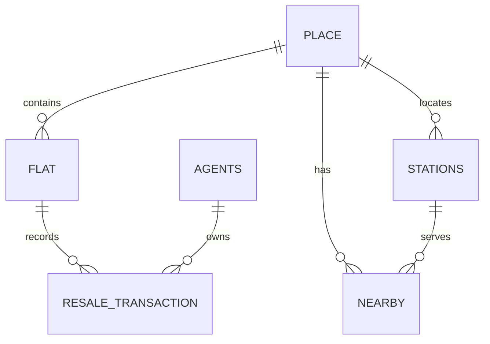

# Estate Records

**Singapore Institute of Technology · INF2003 Database Systems group project**

Estate Records is a Streamlit application for Singapore property agents to maintain HDB flat and resale records, find comparable transactions near MRT and LRT stations, and save their own searches and dashboards. MySQL stores the shared catalogue and transaction history. MongoDB stores each agent’s search criteria and analytics configuration. Loading a saved search or analytics card uses the stored configuration to query MySQL.

## Run the application

Use Python 3.14, MySQL Server 8.0.18 or newer, and a running MongoDB server. Use a fresh local MySQL schema and an empty MongoDB database for the grading demo. Run the following commands from the repository root in PowerShell.

1. **Install Python dependencies and create the local configuration.**

   ```powershell
   python -m venv .venv
   .\.venv\Scripts\python.exe -m pip install -r requirements.txt
   Copy-Item .env.example .env
   ```

   Set `MYSQL_USER` and `MYSQL_PASSWORD` in `.env`. Set `FLAT_RECORD_ADMIN_EMAIL` to the address you want to use for the demo administrator. Adjust the database host, port, or MongoDB URI if your services use different settings.

2. **Create the MySQL schema.** Open [setup/firstver_database.sql](setup/firstver_database.sql) in MySQL Workbench and execute the full script. If the MySQL client is on your `PATH`, you can also run the command below with an account that can create the schema.

   ```powershell
   mysql --host=localhost --port=3306 --user=YOUR_MYSQL_USER -p --execute="SOURCE setup/firstver_database.sql"
   ```

3. **Import the bundled data and build station distances.** The importer prompts for a password of at least eight characters when it creates the demo administrator. Keep that password for the grading walkthrough.

   ```powershell
   .\.venv\Scripts\python.exe -m setup.import_data_script.import
   .\.venv\Scripts\python.exe -m app.app_modules.nearby.nearby_function
   ```

   See the [data import guide](setup/import_data_script/ImportInstructions.md) for the expected row counts, permissions, and import behavior.

4. **Create the saved-search index.** Run this once for each MongoDB database used by the app. The command uses `MONGODB_URI` and `MONGODB_DATABASE` from your configuration. Use a MongoDB account with index creation permission.

   ```powershell
   .\.venv\Scripts\python.exe -c "from app.app_modules.database import database as db; from app.app_modules.saved_searches_store import ensure_index; client = db.get_mongodb_client(); print(ensure_index(client[db.get_mongodb_database_name()])); client.close()"
   ```

   The command prints `saved_searches_agent_created_id`. The Analytics page sets up its own MongoDB collections and indexes when first opened. [Saved searches setup and benchmark](docs/saved-searches-mongodb.md#5-create-the-index-once-during-setup)

5. **Start Streamlit.** Open the local URL printed in the terminal, usually `http://localhost:8501`.

   ```powershell
   .\.venv\Scripts\python.exe -m streamlit run app/streamlit_app.py
   ```

   On macOS or Linux, use `.venv/bin/python` for the Python commands and `cp .env.example .env` to create the configuration file.

For a populated Estate Records schema, configure `.env` for that instance and apply the MySQL upgrade to install the resale detail view and other schema updates. Run step 4 for the configured MongoDB database. Use the distance builder if `nearby` still needs to be populated. [MySQL upgrade guide](setup/mysql_upgrade.md#upgrade-an-existing-schema)

### Configuration

| Variable | Purpose | Example or default |
| --- | --- | --- |
| `MYSQL_HOST`, `MYSQL_PORT` | MySQL server address | `localhost`, `3306` |
| `MYSQL_DATABASE` | Schema created by the bundled SQL | `estateRecordsDB` |
| `MYSQL_USER`, `MYSQL_PASSWORD` | Credentials for the app and seed importer | Set locally |
| `MONGODB_URI`, `MONGODB_DATABASE` | MongoDB server and document database | `mongodb://localhost:27017`, `estate_records` |
| `FLAT_RECORD_ADMIN_EMAIL` | Account permitted to create and edit flats. The importer assigns the bundled transactions to this account. | `admin@example.com` in the example file |
| `FLAT_RECORD_ADMIN_PASSWORD` | Optional password supplied by the process for unattended import. The importer otherwise prompts when creating the account. | Unset |
| `ONEMAP_API_TOKEN` | Token for the optional HDB geocoding script | Unset |

Environment variables already set in the shell take precedence over `.env`. Keep `.env` local. Public registration reserves the configured administrator email for the seed importer or an existing provisioned account.

## Grading walkthrough

1. **Search and filter.** Register a regular agent, then run **Search & filter** for **TAMPINES**, **4 ROOM** and save it as **Tampines 4-room resale**. MySQL joins transactions, flats, and places and displays up to 1,000 matches.
2. **Joins, comparables, and rankings.** Open **Address** to inspect station coverage. In **Nearby stations**, filter for **≤ 500 m**, select a flat, and open **Recent comparable sales** with the **500 m** catchment. Review the sample count, median price per square metre, chart, and matching sales. Choose **Download comparable sales CSV** to export the displayed rows. Open **Ranking** to compare towns, station areas, streets, and individual sales. Capture market screenshots before adding demonstration sales.
3. **Relational CRUD and atomic rollback.** Under **My transactions**, choose **Batch create** and add two drafts for the same existing flat ID on your new agent account. Click **Commit batch** and check the rollback notice and both retained drafts. Open **Create** to verify the agent's transaction list is empty. Return to **Batch create**, change the second draft to a different existing flat ID, and commit again. Verify that both sales are saved, then use **Update** to change one sale's price and **Delete** to remove it. Every agent can browse **Flat records**. Sign in as the seeded administrator to create or edit a flat.
4. **Saved searches in MongoDB.** Open **Saved searches** and select **Tampines 4-room resale**. Edit its name, set a maximum price of `700000` and a start date of `2025-01-01`, then click **Save changes**. Choose **Run saved search** to reopen **Search & filter** with those values and query MySQL. Open **Saved searches** again to delete the saved document.
5. **Analytics across both databases.** Open **Analytics** to load the default cards. Create a card in the visual query builder, for example the average resale price grouped by town. Save and duplicate the card. MongoDB stores the card configuration and MySQL executes the query used by the chart, table, or KPI.

## Database design

### MySQL



| Table | Role and constraints |
| --- | --- |
| `agents` | Agent profile with a generated integer ID, unique email, and salted scrypt password hash. |
| `place` | Address and `DECIMAL(18,15)` coordinates keyed by `block_id`. The SQL column `longtitude` uses the spelling in the project schema. |
| `flat` | Flat attributes, `DECIMAL(7,2)` floor area, and lease information. `block_id` is a foreign key to `place`. |
| `stations` | Rail stop and line details. Each station code is unique and references its location in `place`. |
| `nearby` | Many-to-many association between places and stations. The composite key identifies the pair and `distance_m` stores its distance. |
| `resale_transaction` | Sale date and `DECIMAL(12,2)` price, with a composite key of flat ID and agent ID. The key allows one transaction per flat per agent. |

For nearby lookup, MySQL filters candidate locations by a coordinate bounding box and computes straight-line distances with `ST_Distance_Sphere`. A `ROW_NUMBER()` window query picks the closest station for places with no match inside the default 1 km radius. The ranking queries use grouping and aggregate measures such as sales count and average resale price per square metre. Station catchments can overlap.

The `v_resale_detail` view joins resale transactions to their flat and address details and computes resale price per square metre. **Recent comparable sales** uses the view to find recent sales of the same flat type. Station-radius searches require the reference and comparable flats to be within the selected distance of a shared station. The same-block and same-town options use address boundaries. Fresh schema setup and the MySQL upgrader install the view.

The application binds transaction search parameters and scopes transaction edits and deletions to the signed-in agent. Analytics validates a single `SELECT` or `WITH` query, runs it in a read-only transaction, and returns at most 5,000 rows. The Analytics page caches query results for ten minutes or until refreshed.

The [MySQL upgrade and benchmark guide](setup/mysql_upgrade.md) explains the B+ tree indexes, their query plans, and how to reproduce the measurements.

### MongoDB

| Collection | Document shape and role |
| --- | --- |
| `saved_searches` | `_id`, `agent_id`, `name`, a nested `filters` document with town, flat type, price and date bounds, and `created_at`. |
| `analytics_cards` | `_id`, `agent_id`, title, SQL, display settings, field mappings, position, and timestamps. Builder cards also keep the editable builder configuration. |
| `analytics_meta` | One `agent_id` and `seeded_at` per agent to track initial creation of the default cards. |

`agent_id` references the MySQL agent at the application layer. The app queries and changes each agent’s own documents. The saved-search index on `(agent_id ASC, created_at DESC, _id DESC)` supports the owner's list in newest-first order with a tie-break for searches created on the same date. The analytics store indexes cards by agent and position and uses a partial unique index on `(agent_id, seed_key)` to prevent duplicate default cards. An agent sees current MySQL results when running a saved search, and the saved criteria remain in MongoDB.

## Datasets and preparation

The setup folder includes the data needed for a complete local run.

| Bundled input | Contents |
| --- | --- |
| `hdb_resale_enriched_block_id.csv` | 242,634 HDB resale records from January 2017 through October 2026, linked to block IDs. Each row seeds a flat and a related transaction. The source gives the registration month and the importer stores its last day as the MySQL date. |
| `places_for_mysql.csv` | 9,964 location records with block IDs, addresses, towns, and coordinates. |
| `mrt_lrt_full_list.csv` | 203 MRT/LRT station codes with their line, transport type, and linked place. An interchange can have multiple codes. |

Market rankings and comparables use the shared resale table, which contains the imported HDB records and any agent-entered sales. Comparable-sale periods count back from the latest recorded sale date. Imported dates represent registration months stored at month-end.

The HDB registration data is published by the Housing & Development Board. The optional geocoding workflow uses the Singapore Land Authority’s OneMap Search API. [HDB resale dataset](https://data.gov.sg/collections/189/datasets/d_8b84c4ee58e3cfc0ece0d773c8ca6abc/view) · [OneMap Search API](https://www.onemap.gov.sg/apidocs/search)

The rail input in the team's `raw_data.zip` matches Timothy Lim's legacy `mrt_lrt_stations.csv` after line-ending normalization. The bundled file retains all 203 station codes and rounds the legacy coordinates to 10 significant digits. Each code gets a `block_id` and an uppercased station-name label in the `Town` column. CZTanData's separate coordinate file supplied the 172-row station sample. [Railway source verification](docs/rail-data-provenance.md)

For optional data preparation, put `hdb_resale_transactions.csv` and `mrt_lrt_full_list.csv` in the local `data/raw/` directory. Run `00_inspect.py`, `03_clean_hdb.py`, `04_clean_mrt.py`, and `05_make_samples.py` from `data/scripts/data_prep/` to inspect and clean the inputs and produce sample files. The station cleaner produces a station-name-level output. With a valid OneMap token, run `06_geocode_hdb.py` followed by `07_merge_geo.py` to attach coordinates and produce `data/cleaned/hdb_resale_enriched.csv`.

The team prepared the bundled HDB file by adding postal codes from OneMap and assigning a `block_id` to each unique address. The MySQL importer starts from the three bundled files in the table above. [Dataset preparation and verified links](setup/import_data_script/ImportInstructions.md#how-the-import-files-were-prepared)

## Repository map

| Path | Contents |
| --- | --- |
| [app/streamlit_app.py](app/streamlit_app.py) | Streamlit entry point, shared styling, and workspace navigation. |
| [app/repository.py](app/repository.py) | SQL access for agent, flat, transaction, address, nearby, and ranking queries. |
| [app/workspace_pages/](app/workspace_pages/) | Renderers for the eight authenticated workspace pages. |
| [app/app_modules/](app/app_modules/) | Login and registration UI, database connections, password helpers, and feature logic for nearby stations, ranking, and analytics. |
| [setup/](setup/) | MySQL schema, migration and benchmark commands, import module, and the full dataset. |
| [data/](data/) | Preparation scripts, committed samples, and working folders for raw, cleaned, and geocoded CSVs. |
| [test/](test/) | Unit tests for the SQL repository, password handling, rankings, and analytics, plus opt-in MySQL integration tests. |
| [requirements.txt](requirements.txt) and [.env.example](.env.example) | Python dependencies and local configuration template. |

## Verification

```powershell
.\.venv\Scripts\python.exe -m pip check
.\.venv\Scripts\python.exe -m unittest discover -s test -v
```
